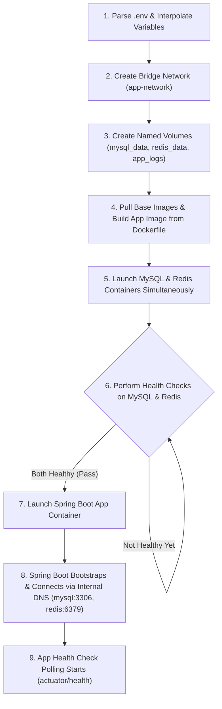

# Docker Compose Workflow & Line-by-Line Breakdown

This document provides a step-by-step workflow execution guide for `docker compose up` and a complete line-by-line syntax analysis of `docker-compose.yml` for the Inventory SaaS project.

---

## Part 1: Step-by-Step Workflow When You Run `docker compose up`

When you run `docker compose up` in your terminal during development, Docker Engine and Compose execute the following sequence:



### Step 1: Environment Variable Parsing & Interpolation
Docker Compose reads your shell environment and any `.env` file in the project folder. It replaces all `${VAR:-default}` placeholders (e.g. `${PROJECT_NAME:-myproject}` becomes `myproject` if `PROJECT_NAME` isn't set).

### Step 2: Network Creation
Docker creates a virtual software bridge network on your host system named `myproject-network`. This isolated network acts like a local router dedicated to your application's containers.

### Step 3: Volume Provisioning
Docker checks if the physical storage directories (`myproject-mysql-data`, `myproject-redis-data`, `myproject-app-logs`) exist on your host machine under `/var/lib/docker/volumes/`. If they don't exist, Docker creates them.

### Step 4: Image Pulling & Local Dockerfile Building
* Docker checks if `mysql:8.0` and `redis:7-alpine` are present in your local image cache. If not, it downloads them from Docker Hub.
* Docker looks at `app.build`: context `.` and builds your Spring Boot container image using your local Dockerfile.

### Step 5: Infrastructure Service Startup
Docker starts the `mysql` and `redis` containers in parallel. 
* **Note:** The `app` container is **held back** at this stage because of `depends_on: condition: service_healthy`.

### Step 6: Healthcheck Evaluation Phase
Docker periodically executes the health check commands inside the running database and cache containers:
* Every 10 seconds, it runs `mysqladmin ping` inside the MySQL container.
* Every 10 seconds, it runs `redis-cli incr ping` inside the Redis container.
* Once both containers return exit code `0` (healthy), Docker marks them as `healthy`.

### Step 7: Application Launch & Internal DNS Resolution
Now that dependencies are ready, Docker launches the `app` container.
* Spring Boot boots up. When it attempts to connect to `DB_HOST: mysql`, Docker's embedded DNS server resolves the hostname `mysql` directly to the internal IP address of the MySQL container on `app-network`.

### Step 8: App Health Monitoring
Docker begins running `wget --spider http://localhost:8080/actuator/health` every 30 seconds to monitor Spring Boot's health state.

---

## Part 2: Line-by-Line Breakdown & Syntax Guide

Below is the complete analysis of every line in `docker-compose.yml`.

---

### 1. Version Header
```yaml
1: #version: '3.8'
```
* **What / Syntax**: A commented-out YAML line specifying the Docker Compose schema version.
* **Why**: Modern Docker Compose V2 (`docker compose`) deprecated the `version:` top-level attribute because it automatically infers schema features based on the installed Docker Engine version.
* **When to use**: Leave it commented out or remove it when using Docker Compose V2.
* **When NOT to use**: Don't uncomment unless you are forced to use legacy Compose V1 (`docker-compose` with a hyphen).

---

### 2. Services Section Root
```yaml
3: services:
```
* **What / Syntax**: Root dictionary key in Compose where you define all containerized services/components.
* **Why**: Tells Docker Compose that everything underneath represents container instances to run.

---

### 3. MySQL Database Container (`mysql`)

```yaml
4:   mysql:
5:     image: mysql:8.0
```
* **What / Syntax**: Declares a service named `mysql` pulled from the official `mysql:8.0` image on Docker Hub.
* **Why**: Provides the relational database for your SaaS multitenant inventory system.
* **When to use**: Pin specific major/minor tags (like `8.0` or `8.0.35`) in development & production.
* **When NOT to use**: Avoid using `image: mysql:latest` because automatic updates can introduce breaking database engine changes.

```yaml
6:     container_name: ${PROJECT_NAME:-myproject}-mysql
```
* **What / Syntax**: Assigns an explicit name to the container on your host machine. Uses YAML variable fallback syntax: `${VAR:-default}`.
* **Why**: Ensures easy identification when running `docker ps` (e.g. `myproject-mysql`).
* **When to use**: Useful in local development for fixed container naming.
* **When NOT to use**: Avoid setting explicit `container_name` in Docker Swarm or Kubernetes clusters, as it prevents scaling a service to multiple replicas.

```yaml
7:     restart: unless-stopped
```
* **What / Syntax**: Restart policy instructing Docker to restart the container if it crashes or host reboots, unless manually stopped by `docker stop`.
* **Why**: Ensures databases auto-recover from transient crashes during development.
* **When to use**: Standard for long-lived infrastructure services.
* **When NOT to use**: One-off tasks (like data migration scripts or database seeders). Use `restart: "no"` for those.

```yaml
8:     environment:
9:       MYSQL_ROOT_PASSWORD: ${DB_ROOT_PASSWORD:-rootpassword}
10:      MYSQL_DATABASE: ${DB_NAME:-myproject_dev}
11:      MYSQL_USER: ${DB_USERNAME:-appuser}
12:      MYSQL_PASSWORD: ${DB_PASSWORD:-apppassword}
13:      TZ: UTC
```
* **What / Syntax**: Environment variables passed into the container at startup.
* **Why**: The official MySQL image uses these variables on first startup to initialize the root password, default database name (`myproject_dev`), and non-root user credentials. `TZ: UTC` ensures time-zone consistency.
* **When to use**: Essential for container initialization.
* **When NOT to use**: Avoid hardcoding real passwords in the YAML file for public production repos. Use `.env` files or secret managers instead.

```yaml
14:    ports:
15:      - "${DB_PORT:-3306}:3306"
```
* **What / Syntax**: Port mapping syntax: `"HOST_PORT:CONTAINER_PORT"`.
* **Why**: Binds port 3306 inside the container to port 3306 on your host machine, allowing tools like DBeaver, DataGrip, or MySQL Workbench to connect directly from your laptop.
* **When to use**: Helpful in local development for DB debugging.
* **When NOT to use**: In production, do **not** expose database ports directly to the internet unless strictly protected behind a VPN/firewall.

```yaml
16:    volumes:
17:      - mysql_data:/var/lib/mysql
```
* **What / Syntax**: Mounts a Docker named volume `mysql_data` to MySQL's internal data directory `/var/lib/mysql`.
* **Why**: Containers are ephemeral (their filesystem is erased when recreated). This guarantees your database data persists when you stop/restart containers.
* **When to use**: Mandatory for stateful databases.
* **When NOT to use**: Stateless services (like frontend web servers or worker nodes).

```yaml
18:    networks:
19:      - app-network
```
* **What / Syntax**: Connects the `mysql` service to `app-network`.
* **Why**: Allows Spring Boot (`app`) to reach MySQL securely over the internal network using hostname `mysql`.

```yaml
20:    healthcheck:
21:      test: ["CMD", "mysqladmin", "ping", "-h", "localhost", "-u", "root", "-p${DB_ROOT_PASSWORD:-rootpassword}"]
22:      interval: 10s
23:      timeout: 5s
24:      retries: 5
25:      start_period: 30s
```
* **What / Syntax**:
  * `test`: Command to execute inside container to test health (`mysqladmin ping`).
  * `interval`: Run healthcheck every 10 seconds.
  * `timeout`: Fail check if it takes longer than 5 seconds.
  * `retries`: Mark as `unhealthy` after 5 consecutive failures.
  * `start_period`: Gives MySQL 30 seconds to boot up before counting healthcheck failures.
* **Why**: Ensures Docker knows when MySQL engine is fully initialized and accepting SQL queries.
* **When to use**: Critical when downstream services depend on database availability at startup.

```yaml
26:    command:
27:      - --character-set-server=utf8mb4
28:      - --collation-server=utf8mb4_unicode_ci
29:      - --max_connections=500
```
* **What / Syntax**: Overrides the default command passed to `mysqld`.
* **Why**:
  * Enforces `utf8mb4` encoding (supports full Unicode & emojis in inventory descriptions).
  * Increases connection limit to 500 to handle multi-tenant connection pools.
* **When to use**: Fine-tuning database engine parameters.

---

### 4. Redis Cache Container (`redis`)

```yaml
33:  redis:
34:    image: redis:7-alpine
35:    container_name: inventory-redis
36:    restart: unless-stopped
```
* **What / Syntax**: Redis version 7 running on lightweight Alpine Linux (~30MB).

```yaml
37:    command: >
38:      redis-server
39:      --appendonly yes
40:      --appendfsync everysec
41:      --maxmemory 512mb
42:      --maxmemory-policy allkeys-lru
43:      --requirepass ${REDIS_PASSWORD:-}
```
* **What / Syntax**:
  * `>`: YAML scalar block modifier that converts multiline strings into a single space-separated line.
  * `--appendonly yes`: Enables AOF (Append-Only File) logging to disk.
  * `--appendfsync everysec`: Writes data to disk every second (good balance between performance & safety).
  * `--maxmemory 512mb` & `allkeys-lru`: Caps Redis RAM to 512MB and evicts Least-Recently-Used keys when full.
* **Why**: Configures Redis to operate reliably as a persistent cache and session/PubSub server for your SaaS app without running out of RAM.

```yaml
44:    ports:
45:      - "${REDIS_PORT:-6379}:6379"
46:    volumes:
47:      - redis_data:/data
48:    networks:
49:      - app-network
```
* **What / Syntax**: Exposes port 6379, persists `/data` directory to `redis_data` volume, and attaches to `app-network`.

```yaml
50:    healthcheck:
51:      test: ["CMD", "redis-cli", "--raw", "incr", "ping"]
52:      interval: 10s
53:      timeout: 3s
54:      retries: 5
```
* **What / Syntax**: Sends a ping command via `redis-cli` to verify Redis responsiveness.

---

### 5. Spring Boot Application Container (`app`)

```yaml
57:  app:
58:    build:
59:      context: .
60:      dockerfile: Dockerfile
```
* **What / Syntax**: Tells Docker Compose to build an image dynamically using your project's root directory (`.`) and `Dockerfile`.
* **Why**: Builds your Java/Spring Boot code into a container image automatically during `docker compose up`.
* **When to use**: Perfect for your own custom backend/frontend code in development.
* **When NOT to use**: When using pre-built third-party images from registries (use `image:` instead).

```yaml
61:    container_name: ${PROJECT_NAME:-myproject}-app
62:    restart: unless-stopped
```
* **What / Syntax**: Names the app container.

```yaml
63:    depends_on:
64:      mysql:
65:        condition: service_healthy
66:      redis:
67:        condition: service_healthy
```
* **What / Syntax**: Defines explicit startup dependencies with `condition: service_healthy`.
* **Why**: Prevents Spring Boot from starting up (and immediately crashing with connection errors) until MySQL and Redis are fully operational and healthy.
* **When to use**: Highly recommended for microservices/web apps that depend on databases.
* **When NOT to use**: Simple `depends_on` (without condition) only waits for container creation, **not** readiness, which causes race conditions.

```yaml
68:    environment:
69:      SPRING_PROFILES_ACTIVE: ${SPRING_PROFILES_ACTIVE:-dev}
70:      DB_HOST: mysql
71:      DB_PORT: 3306
72:      DB_NAME: ${DB_NAME:-myproject_dev}
73:      DB_USERNAME: ${DB_USERNAME:-appuser}
74:      DB_PASSWORD: ${DB_PASSWORD:-apppassword}
75:      REDIS_HOST: redis
76:      REDIS_PORT: 6379
77:      REDIS_PASSWORD: ${REDIS_PASSWORD:-}
78:      JWT_SECRET: ${JWT_SECRET}
79:      LOGGING_LEVEL_ROOT: ${LOGGING_LEVEL_ROOT:-INFO}
80:      LOGGING_LEVEL_APP: ${LOGGING_LEVEL_APP:-DEBUG}
```
* **What / Syntax**: Environment variables injected into your Spring Boot runtime.
* **Why**: Overrides `application.yml` properties dynamically. `DB_HOST: mysql` and `REDIS_HOST: redis` reference the exact Docker Compose service names, allowing Spring Boot to connect seamlessly across containers.

```yaml
83:    ports:
84:      - "${APP_PORT:-8081}:8080"
```
* **What / Syntax**: Maps port 8081 on host to port 8080 inside container.
* **Why**: You can access your backend REST API from your host browser/Postman at `http://localhost:8081`.

```yaml
86:    volumes:
87:      - app_logs:/var/log/app
```
* **What / Syntax**: Mounts the volume `app_logs` to preserve application log files.

```yaml
88:    networks:
89:      - app-network
```
* **What / Syntax**: Connects the app to `app-network` so it can communicate with MySQL and Redis.

```yaml
90:    healthcheck:
91:      test: ["CMD", "wget", "--no-verbose", "--tries=1", "--spider","http://localhost:8080/actuator/health"]
92:      interval: 30s
93:      timeout: 10s
94:      retries: 3
95:      start_period: 60s
```
* **What / Syntax**: Uses `wget` to query Spring Boot Actuator's health endpoint (`/actuator/health`).
* **Why**: Allows Docker and load balancers to detect if Spring Boot has completed initialization (`start_period: 60s`) and is serving traffic.

---

### 6. Networks Section
```yaml
97: networks:
98:   app-network:
99:     driver: bridge
100:    name: ${PROJECT_NAME:-myproject}-network
```
* **What / Syntax**: Top-level declaration of custom networks using the standard `bridge` driver.
* **Why**: Gives all services an isolated private network with built-in DNS auto-resolution.
* **When to use**: Always use explicit custom networks rather than relying on Docker's default bridge network (which lacks automatic DNS name resolution).

---

### 7. Volumes Section
```yaml
102: volumes:
103:   mysql_data:
104:     driver: local
105:     name: ${PROJECT_NAME:-myproject:-myproject}-mysql-data
106:   redis_data:
107:     driver: local
108:     name: ${PROJECT_NAME:-myproject:-myproject}-redis-data
109:   app_logs:
110:     driver: local
111:     name: ${PROJECT_NAME:-myproject:-myproject}-app-logs
```
* **What / Syntax**: Top-level declaration of managed persistent volumes.
* **Why**: Tells Docker to manage named volumes stored on host disk outside container lifecycles.
* **When to use**: Mandatory for stateful data (DBs, caches, persistent logs).

---

## Quick Reference Summary Table

| Feature | Syntax Example | Purpose / Best Practice |
| :--- | :--- | :--- |
| **Variable Fallback** | `${DB_PORT:-3306}` | Use value if set in `.env`, otherwise fallback to `3306`. |
| **Service DNS** | `DB_HOST: mysql` | Target containers by service name over custom bridge networks. |
| **Health Dependencies** | `condition: service_healthy` | Prevents startup race conditions (forces waiting for DB engine readiness). |
| **Named Volumes** | `mysql_data:/var/lib/mysql` | Prevents data loss when containers stop/restart. |
| **Folded YAML Scalar** | `command: >` | Replaces multiline text with a single line for clean CLI flags. |
